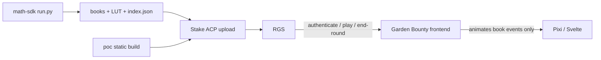

# Garden Bounty — stan wobec Stake.com

Last updated: 2026-09-15

Branch: `docs/stake-com-readiness` (from `origin/main` @ `6e2c43b`)

Target: a real Stake Engine game that can be uploaded to ACP, pass RGS
checks, and ship on stake.com. This document is a snapshot of **what the
repo actually contains today**, not a wish list.

Related: [STAKE_COM_ROADMAP.md](./STAKE_COM_ROADMAP.md),
[GAME_SPEC.md](./GAME_SPEC.md),
[GARDEN_PRODUCTION_TODO.md](./GARDEN_PRODUCTION_TODO.md),
[FUNCTIONAL_QA.md](./FUNCTIONAL_QA.md).

## Verdict

Garden Bounty is a **working visual PoC** on the Stake Engine web SDK. It is
**not** a publishable stake.com game.

The frontend can spin, present wins, open Free Spins chrome, and talk to
RGS once a session exists. A local compressed **100k/mode** math pack
exists (LUT RTP 0.97) but is gitignored and not an ACP upload. Placeholder
IDs, licensed audio, a real Stake developer session, and stripping
`/dev-preview` from the upload are still missing. Spec lock is in
`docs/GAME_SPEC.md`.

`/dev-preview` must never be cited as RTP proof. It uses a local weighted
sampler (`97%` toy table, payouts `0–100×`) instead of the Python math
engine.

## What was verified

Environment on this machine (2026-09-14):

| Tool | Status |
| --- | --- |
| Node | 22.11.0 |
| pnpm / `frontend/node_modules` | present |
| Python | **3.12.10** (default) and 3.11.9 still installed |
| Rust / Cargo | **1.97.1** |
| Math venv `math/env` or `math/.venv` | **`math/.venv` present** (3.12.10, local-only) |
| `math/games/0_0_poc/library/` | gitignored; **100k/mode** compressed pack generated 2026-09-14 |
| Stake ACP credentials / game ID | absent |

Local stack:

- Documented port `3010` is **unusable** here (`EACCES`). Windows Hyper-V
  reserved TCP `2978–3077`.
- Vite served `frontend/apps/poc` at `http://127.0.0.1:4010`.
- `/dev-preview` and `/` both return HTTP 200.

Live tester (desktop 1440×900 and portrait 480×900):

- Garden background, wooden 5×3 frame, vegetable/fruit symbols, sunflower
  token HUD palette, `GARDEN BOUNTY` logo, BET / AUTO SPIN / TURBO / BUY
  BONUS / MENU all render.
- Idle diagnostics: `Balance $1000.00 · Bet $1.00 · Auto 0 · Machine idle`.
- Space/BET through the real actor **did debit** `$1` (`$1000 → $999`) and
  switched BET → STOP. That proves the local demo adapter is wired.
- Portrait 480×900 reflows: WIN on top, control row, BALANCE / BET at the
  bottom. No clipping of the board or primary buttons in this capture.
- `/` without `sessionID` + `rgs_url` stays on the Stake loader
  (`Add Your Loader`) and then the shared authenticate error path. Expected
  without a developer session.

Headless Chrome can stall Pixi rAF, so a stuck `Machine bet` in that
harness is **not** treated as a confirmed production hang. Confirm spin
completion in a real window before filing it as a defect.

## What already exists

### Product shell

- Public presentation: **Garden Bounty**, garden/orchard theme, `theme =
  'garden'`.
- App: `frontend/apps/poc` (Stake Engine `lines` sample fork).
- Board: **5 reels × 3 rows**, **20 paylines**, left-to-right.
- Modes in both frontend and Python: `base` (cost `1.0`) and `bonus` buy
  (cost `100.0`), max win **5000×**.

### Frontend (presentation)

- PixiJS 8 + Svelte 5 + XState game actor from web-sdk.
- Book-event runner: `reveal`, `winInfo`, `setWin`, `setTotalWin`,
  `finalWin`, `freeSpinTrigger`, `updateFreeSpin`, `freeSpinEnd`,
  `createBonusSnapshot`.
- Win ladder including BIG / SUPER / MEGA / EPIC / MAX WIN.
- Free Spins intro, outro, counter (desktop Pixi panel; portrait uses HUD
  label).
- Anticipation, scene transition, garden ambience, sunflower token
  particles.
- HTML paytable and rules (`GardenPayTable`, `GardenGameRules`).
- Production route: `Authenticate` → RGS
  `/wallet/authenticate|play|end-round`, resume via `ResumeBet`, replay
  helper in the shared package.
- `/dev-preview`: local QA adapter, scenario dropdown, diagnostics.
- Jurisdiction flags are **consumed** from authenticate (`autoplay`,
  `turbo`, `buy feature`, RTP display, session timer, min round duration,
  social casino, …). They are not custom-tested against a live RGS.

### Math (source only)

Python game at `math/games/0_0_poc/` (copy of `0_0_lines`):

- Line evaluation, wild with **free-game multipliers**, scatter Free Spins,
  retrigger, win cap, buy-bonus mode.
- Reel strips: `reels/BR0.csv`, `FR0.csv`, `FRWCAP.csv`.
- `run.py` pipeline: simulate → configs → Rust optimizer → PAR sheet → RGS
  format checks.
- Default sim counts in `run.py` are **100k per mode** (`POC_NUM_SIMS`).
  A 100k compressed optimizer run passed 2026-09-14 (LUT RTP 0.97,
  matching book hashes). See `docs/MATH_RUN.md`.

Intended feature (from `game_config.py` + `readme.txt`):

| Feature | Configured behaviour |
| --- | --- |
| Free Spins trigger (base) | 3 / 4 / 5 scatters → 8 / 12 / 15 spins |
| Retrigger (free game) | 2 / 3 / 4 / 5 scatters → 3 / 5 / 8 / 12 extra |
| Wild | Substitutes; multipliers only in free game (min 2×) |
| Buy Bonus | 100× bet, forced free-game book |
| Win cap | 5000× |

`library/publish_files/` exists locally after the 100k/mode run (zst + LUT
+ `index.json`). It is gitignored. Hashes and PAR are in
`docs/MATH_RUN.md`. ACP upload still needs Stake IDs and a developer
session.

### Art / audio

Shipped in the active registry (`assets.ts`): garden background, garden
symbol atlas, garden token atlas, demo sound sprite.

Intentionally reused from the miner/demo sample: **H4 shovel**, **H5
pickaxe-style art**, **all audio**. Demo Spine/sprites remain on disk but
are unregistered.

## Gaps vs a real stake.com game

### P0 — cannot publish without these

1. **Math pack is local-only.** A compressed 100k/mode `library/publish_files/`
   set exists on this machine (LUT RTP 0.97, hashes in `MATH_RUN.md`) but is
   gitignored and has never been uploaded to Stake ACP. A clean checkout
   cannot publish.
2. **Spec lock (done 2026-09-14).** RTP **0.97**, W/H1 **10/20/50**, documented
   in `GAME_SPEC.md`. Parity test: `math/tests/test_config_parity_poc.py`.
   Still do not generate books until a debug batch validates events.
3. **Placeholder identity.** `providerName: poc_studio`,
   `gameName: poc_slot`, `gameID: 0_0_poc`, Python working name
   `PoC Slot (Lines)`, UI version `0.0.0`. Stake assigns the real team /
   game ID / version.
4. **No ACP session.** Authenticate/play/end-round, resume, replay,
   currencies, jurisdiction, iframe QA — all untested against real RGS.
5. **Audio (+ H4/H5) licensing.** Demo sample assets. Commercial reuse is
   undocumented. Do not assume Stake sample packs are cleared for a
   commercial title.

### P1 — game would ship broken or incomplete

6. **Book-event handlers (done 2026-09-14).** `wincap` and
   `freeSpinRetrigger` are typed and handled in `poc`. Retrigger updates
   the FS counter without a second intro; wincap plays the MAX WIN ladder.
7. **Title split (done 2026-09-14).** HUD ticker is `20 LINES • GARDEN BOUNTY`.
8. **H5 is art-only.** Present in the atlas and `constants.ts`; removed from
   the local demo sampler and paytables.
9. **L5 is a 2× harvest badge** and is listed in the HTML paytable
   (0.1 / 0.3 / 1).
10. **Local demo is not the game.** 5-row random boards, toy RTP table,
    Buy Bonus is a **1-spin zero-win** stub. Useful for UI, useless for
    math sign-off.
11. **i18n.** RGS advertises 16 languages. Game + shared UI maps are
    `en` + `zh` only. Social-casino copy (`BET` → `SPIN`) exists in the
    SDK when `social=true`.
12. **`/dev-preview` in the production build.** `adapter-static` prerenders
    `src/routes/dev-preview`. Must be removed or proven unreachable from
    the uploaded `index.html`.
13. **H1 headlamp (done 2026-09-15).** Miner lamp and circular outline removed
    with local Qwen Image Edit + BiRefNet.

### P2 — release hygiene

14. Inactive demo Spine/sprites still on disk.
15. `DEMO_ASSET_AUDIT.md` still describes the miner presentation.
16. Repository license is the Stake Engine MIT on the math tree; frontend
    has no root LICENSE file. Third-party Typekit (`proxima-nova`) and
    audio provenance need an attribution record.
17. No automated frontend↔Python parity test on `main`.
18. Storybook books (`bonus_books.ts`) are still the stock `lines` sample
    (including 5-high boards and `freeSpinRetrigger`), not Garden math.

## Architecture (what Stake actually runs)

The frontend must not compute wins. RGS picks a book by lookup weight;
the client only plays `events[]`. Until books exist, stake.com play is
impossible.

## Prior local work

Phase 0 spec lock and Phase 1 100k/mode books are done on this machine
(`docs/GAME_SPEC.md`, `docs/MATH_RUN.md`). `library/` stays gitignored, so
another checkout must regenerate or copy the pack. ACP still needs Stake
IDs.

## Definition of “ready for Stake review”

- Frontend and Python configs identical where RGS/FE require it.
- `publish_files/` present for `base` and `bonus`, hashes valid, RTP
  matches the locked spec.
- Production build from a clean checkout; `/dev-preview` not reachable
  from the release entry.
- Real developer session: authenticate, play, buy bonus, end-round,
  interrupt/resume, replay, errors, jurisdiction flags, desktop + iframe
  portrait.
- Every shipped visual and audio file has documented commercial rights.
- Final game ID, version, and rollback artifact recorded.
