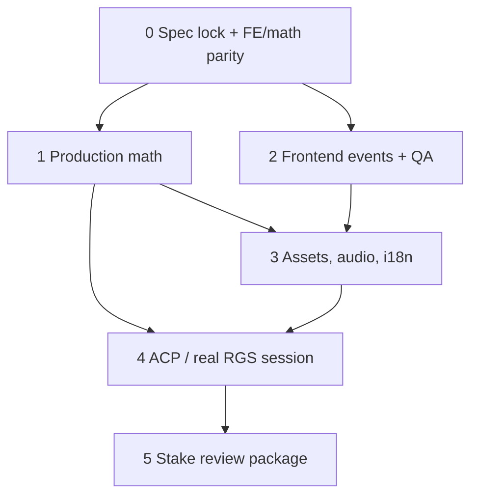

# Garden Bounty — plan do pełnej gry na Stake.com

Last updated: 2026-09-15

Branch: `docs/stake-com-readiness`

This is the execution plan. Current snapshot:
[STAKE_COM_READINESS.md](./STAKE_COM_READINESS.md). Daily checkboxes stay in
[GARDEN_PRODUCTION_TODO.md](./GARDEN_PRODUCTION_TODO.md).

Do not start a 5×5 conversion, a new math model, or a full art regen
unless a phase below explicitly says so. Preserve symbol keys, book-event
names, and the `garden` theme isolation.

## Locked product (until Stake says otherwise)

These are the mechanics already in the Python source. The job is to make
frontend, math output, and copy **agree**, then publish them.

| Spec | Value |
| --- | --- |
| Title | Garden Bounty |
| Model | 5×3 lines, 20 paylines |
| Modes | `base` cost 1.0; `bonus` buy-bonus cost 100.0 |
| Max win | 5000× |
| Free Spins | 3/4/5 scatters → 8/12/15; free-game retrigger 2+ |
| Wild | Substitute; multipliers in free game only |
| Buy Bonus | Ship it; RGS jurisdiction can still disable it |
| RTP | **Choose one number and write it in both configs** before books |

Recommended RTP lock: **0.97** (matches current frontend + rules copy).
If Stake/jurisdiction requires the SDK 3-star reference **0.967**, change
the frontend and HTML rules to 0.967 instead. Do not leave a split.

Paytable lock: pick **one** of Python or frontend as canonical, then copy
it everywhere (`config.ts`, `game_config.py`, `GardenPayTable.svelte`,
generated `config_fe_*.json`). Today they disagree on W and H1.

H5: keep as unused atlas spare **or** add it to math. Do not leave it in
the local demo sampler if it is not a paying symbol.

## Phases



### Phase 0 — spec lock (days, not weeks)

Exit: a short `docs/GAME_SPEC.md` and identical numbers in FE + Python.

1. Confirm with the operator: public title, whether Buy Bonus is allowed
   in target markets, RTP, max win, and whether stake.us (social casino)
   is in scope.
2. Reconcile RTP and the full paytable (W, H1, and HTML paytable). Add
   L5 to the HTML paytable; document H5 as art-only or put it in math.
3. Fix copy: ticker `GARDEN HARVEST` → `GARDEN BOUNTY`; rules RTP line
   must match the locked RTP.
4. Add `math/tests/test_config_parity_poc.py` (or equivalent) covering
   symbols, paytable, paylines, RTP, mode costs, max win, dimensions.
5. Leave `poc_studio` / `0_0_poc` / `0.0.0` until Stake issues IDs, but
   list them as placeholders in the spec.

### Phase 1 — production math

Exit: `math/games/0_0_poc/library/publish_files/` for `base` and `bonus`.

Tooling on this PC is sufficient (Python 3.12.10 + Rust 1.97.1).
`math/.venv` and `optimization_program/Cargo.toml` are in place
(gitignore exception for the crate manifest). `run.py` defaults to 100k
per mode; `POC_DEBUG_BATCH=1` is the uncompressed shortcut.

1. `python -m venv math/.venv` with 3.12; `pip install -r math/requirements.txt`
   and editable install of the math package.
2. Debug batch: uncompressed, ~100–500 sims per mode. Manually open
   books and assert every `type` is handled by `bookEventHandlerMap`
   (this will fail on `wincap` / `freeSpinRetrigger` until Phase 2).
3. Raise `run.py` to **≥100k** outcomes per mode (increase if lookup
   diversity or tail quality is poor).
4. Run optimizer against the locked RTP. Confirm LUT RTP equals the spec
   to the RGS integer precision.
5. Generate PAR/stat: RTP split (base / free / cap), hit rate, bonus
   frequency, average bonus value, volatility, max-win rate.
6. `execute_all_tests` / format checks. Inspect `index.json`, CSV row
   counts, `.jsonl.zst`, payout hashes.
7. Keep `library/` gitignored. Record hashes, RTP, and PAR summary in
   `docs/MATH_RUN.md` (or the production TODO log) so the next machine
   can reproduce.

Do not tune volatility until Phase 0 numbers are frozen. Changing
paytable or strips after a 100k run means running it again.

### Phase 2 — frontend events and functional QA

Exit: every math event type has a handler; desktop + 480×900 QA pass in
a **real** browser (not headless-only).

1. Add `wincap` and `freeSpinRetrigger` to `typesBookEvent.ts` and
   `bookEventHandlerMap.ts`. Use `cluster` as the retrigger reference;
   max-win should use the existing win-level `max` presentation.
2. Drive `/dev-preview` (and later real books) through: base miss, line
   win, wild multiplier in FS, 3/4/5 scatter trigger, retrigger, buy
   bonus, 5000× cap, zero-win bonus, BIG WIN continue.
3. After every flow: `Auto 0 · Machine idle`.
4. Repeat at 480×900. Portrait HUD already reflowed in the 2026-09-14
   capture; still verify modals, FS counter, and buy-bonus dialog.
5. **Done 2026-09-15:** H1 miner headlamp and circular outline removed with
   local Qwen Image Edit (seed `9302105`) + BiRefNet.
6. `git diff --check` + `npm run build` from `frontend/apps/poc`.
7. Optional: replace the local demo sampler so it cannot emit H5 and so
   bonus books look like real FS (not a 1-spin $0 stub). Still not RTP
   evidence. **Done 2026-09-14:** H5 is out of the sampler; Buy Bonus now
   plays a 3-spin FS book with wild 2×, retrigger, and a 20× credit.

If port `3010` is blocked, serve on `4010` (or any free port outside
Hyper-V exclusions) and update the tester URL in the run notes.

### Phase 3 — assets, audio, i18n, package hygiene

Exit: every file in the uploaded build has a rights record.

1. Replace H4/H5 and the demo sound sprite, **or** file written
   permission to reuse them.
2. Update `DEMO_ASSET_AUDIT.md` to the garden runtime (it still reads as
   miner).
3. Quarantine unregistered demo Spine only after a search of dynamic
   keys, Storybook, and a production build.
4. i18n: at minimum translate game rules/paytable/HUD for languages
   Stake requires for the first market. Shared UI today is `en`/`zh`.
5. If stake.us is in scope, walk the `social=true` strings (SPIN vs BET).
6. Strip or guard `/dev-preview` in the uploaded build.
7. Version the FE package to the Stake-approved semver once IDs exist.

### Phase 4 — Stake Engine developer integration

Exit: a developer session on engine.stake.com plays like production.

External blockers (cannot invent): ACP login, team/provider, game ID,
upload permission.

1. Upload math `publish_files` and the static frontend build.
2. Publish frontend + math, start a session, launch with
   `sessionID`, `lang`, `device`, `rgs_url` from the URL (never hardcode
   RGS).
3. Wallet: authenticate, balance, bet levels, min/max/step/default,
   currencies including XGC/XSC if social is in scope.
4. Play: base, buy bonus, settlement, `end-round` timing (single-round
   win vs bonus — see web-sdk `BET_TYPE_METHODS_MAP`).
5. Recovery: refresh mid-round, resume, replay, duplicate action,
   insufficient funds, `ERR_IS` / maintenance modals.
6. Jurisdiction matrix: autoplay, turbo, slam stop, spacebar, fullscreen,
   buy feature, RTP display, net position, timer, minimum round duration.
7. Desktop + Stake iframe sizes, audio lifecycle, low-end performance.

### Phase 5 — review package

Exit: one immutable frontend hash + one math hash submitted for review.

1. Release notes, PAR sheet, QA evidence, known limitations, rollback
   build.
2. License/attribution (SDK MIT, Typekit, audio, Comfy-generated art
   prompts under `tools/comfy`).
3. Submit, fix ACP/RGS findings, promote **only** the reviewed pair.

## Bonus systems — what to build vs what to invent

Already in the math source; implement/present, do not redesign:

- Scatter Free Spins with a separate free reel strip.
- Retrigger during FS.
- Wild multipliers on free-game wilds (weighted 2×–50×).
- Buy Bonus at 100×.
- 5000× hard cap (`wincap` books).

Out of scope unless product explicitly reopens the GDD:

- New bonus games (pick, hold-and-spin, tumble, cluster).
- Extra bet modes beyond `base` / `bonus`.
- 5×5 board (separate math project).
- Changing symbol keys (`H1`…`L5`, `W`, `S`).

If a richer bonus is wanted later, add it as a **new book-event +
distribution** after Phase 1 books are reproducible — not by hacking
`/dev-preview`.

## Suggested order of the next coding tasks

1. Phase 0 config parity + title/paytable copy (small PR).
2. Phase 2 `wincap` / `freeSpinRetrigger` handlers (small PR).
3. Phase 1 venv + 100-sim debug books, then 100k (does not belong in git).
4. Real-window `/dev-preview` regression (desktop + 480×900).
5. Audio/H4/H5 decision.
6. ACP upload when credentials exist.

## Effort sketch (calendar, one developer)

| Phase | Rough duration | Depends on |
| --- | --- | --- |
| 0 Spec lock | 1–2 days | Product RTP/Buy Bonus decision |
| 1 Math | 3–7 days first successful publish pack; more if strips need retune | 0, Python 3.12 venv, Cargo.toml |
| 2 FE events + QA | 2–4 days | 1 debug books help, not strictly required |
| 3 Assets / i18n | 3–10 days | Licensing answers |
| 4 RGS session | 3–5 days | ACP access |
| 5 Review | Stake queue | 0–4 done |

Math retunes (RTP miss, ugly hit rate, too-rare bonus) can add a week.

## Commands

Frontend tester (if `3010` is excluded, use `4010`):

```powershell
cd frontend\apps\poc
..\..\node_modules\.bin\vite.cmd --host 127.0.0.1 --port 4010
```

Open `http://127.0.0.1:4010/dev-preview`.

Production build:

```powershell
cd frontend\apps\poc
npm run build
```

Math (after venv + optimizer are installed):

```powershell
cd math\games\0_0_poc
python run.py
```

Headless layout smoke (not RTP proof): `node tools/qa/chrome_devpreview_qa.mjs`
with Vite already running. See `tools/qa/README.md`.
